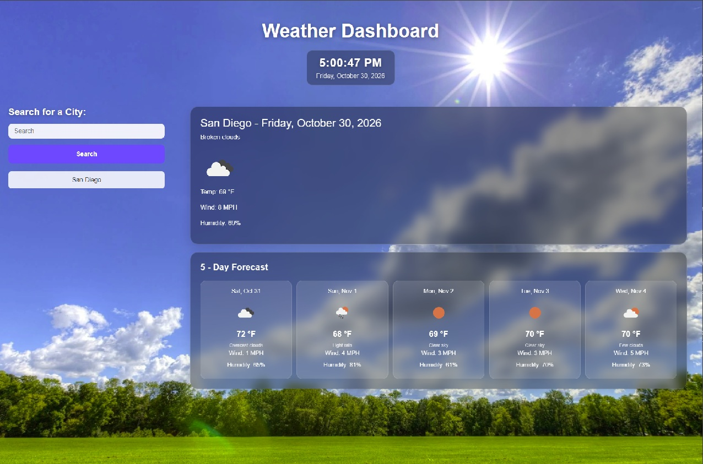

# Weather Dashboard: City Weather and Five-Day Forecast

A responsive weather app that shows the current conditions and a five-day forecast for any city, with your recent searches saved for one-click access.

**Live demo:** https://mnoorzai21.github.io/weather-dashboard-mnn/ (the backend runs on Render's free plan, so the first search after a quiet period can take up to a minute while the server wakes up)



## Features

- **City search:** look up current weather for any city in the world
- **Current conditions:** temperature, humidity, wind speed, and a weather description with an icon
- **Five-day forecast:** one card per day, picked from the forecast's 3-hour readings
- **Search history:** recent cities are saved in the browser, so one click searches again
- **Live date and time:** a clock in the header that updates every second
- **Responsive layout:** works on phones, tablets, and desktops

## Tech Stack

- **Frontend:** HTML, CSS, JavaScript, Bootstrap 4.6
- **Backend:** Node.js, Express 5 (a small API that keeps the OpenWeatherMap key private)
- **Database:** None; search history is stored in the browser's localStorage
- **External API:** OpenWeatherMap (current weather and five-day forecast)
- **Testing & CI:** None yet
- **Hosting:** GitHub Pages (frontend), Render (backend)

## How It Works

```
Browser (GitHub Pages) ──/api/weather?city=…──▶ Express API (Render) ──▶ OpenWeatherMap
        │                                              │
   localStorage                              API key stays on the server
 (search history)
```

- **The API key never reaches the browser.** The frontend calls my Express server, and only the server talks to OpenWeatherMap with the key from an environment variable.
- **Waking the free server early.** Render's free plan sleeps when idle, so the page pings `/api/health` as soon as it loads; by the time the user types a city, the server is usually awake.
- **One request, two results.** The server fetches the current weather first, then uses that city's coordinates to fetch the five-day forecast, and returns both together.